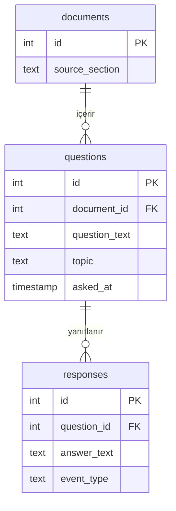

## Veri Modeli

Senaryo: Üniversite öğrencilerinin ders ve yönetmelik sorularını yanıtlayan bir RAG asistanının soru-cevap kayıtları. Kalite ekibi bozuk kayıtları (boş ya da model analiz metni içeren satırlar) izlemek istiyor. Veri: Hugging Face `Aaron616/UWP-Instruct-Train`, 1.450 özgün satır.

### 2.1 Güncel ERD

Vizedeki ERD'den farklar: `documents` tablosu hiçbir tabloya bağlı değildi, artık `questions.document_id` ile bağlı. `question_length` ve `answer_length` sütunları kaldırıldı (gerekçe 2.2'de). `asked_at` veri setinde olmadığı için rastgele üretildi (veri kartında belirtildi).

İlişkiler:

- Bir `document`, en az sıfır, en çok çok sayıda `question` içerir; bir `question`, tam olarak bir `document`'e aittir (1-N; `questions` tarafı zorunlu katılım, `documents` tarafı isteğe bağlı).
- Bir `question`, en az sıfır, en çok çok sayıda `response`'a sahiptir; bir `response`, tam olarak bir `question`'a aittir (1-N; `responses` tarafı zorunlu katılım, `questions` tarafı isteğe bağlı).

### 2.2 Normalizasyon notu

| Tablo | Neden ayrıldı / ayrılmadı | Form |
|---|---|---|
| `documents` | `source_section` metni binlerce soruda tekrar ediyordu; belge bilgisi `questions.id → document_id → source_section` zinciriyle dolaylı belirleniyordu. Tek yere alındı. | 3NF |
| `questions` | `question_text`, `topic`, `asked_at` doğrudan soru kimliğine (`id`) bağlı. `topic` ayrı tablo olmadı: üzerinde başka öznitelik yok. | 3NF |
| `responses` | Yanıt, sorudan ayrı bir olay: model yanıtı yeniden üretilebilir, `event_type` yanıtın durumunu işaretler. `answer_text` ve `event_type` yalnızca `id`'ye bağlı. | 3NF |

Form örnekleri:

- **1NF:** Ham veride `category` sütunu "sol | sağ" biçiminde tek hücrede iki değer taşıyordu. `source_section` ve `topic` olarak bölünüp atomik hâle getirildi.
- **2NF:** Üç tablonun anahtarı da tek sütun (`id`), bu yüzden kısmi bağımlılık oluşamaz. Örnek: `responses.answer_text`, anahtarın tamamı olan `id`'ye bağlıdır.
- **3NF:** `question_length` ve `answer_length` sütunları, anahtar olmayan `question_text` ve `answer_text` sütunlarından hesaplanabiliyordu (anahtar olmayan sütun başka sütunu belirliyor). Kaldırıldı; gerektiğinde `length(question_text)` ile hesaplanır.

### 2.3 İki JOIN sorusu

**Soru 1 (eşleşmeyen kayıt):** Hiç soru gelmemiş belge bölümleri hangileri?

- Birleşme: `documents d` ve `questions q`, `d.id = q.document_id`
- Tür: `LEFT JOIN`, sonra `WHERE q.id IS NULL`
- Neden: Bütün belgeler listede kalmalı. `INNER JOIN` sorusu olmayan belgeleri satırdan atardı; `LEFT JOIN`'de bu belgelerin `q` tarafı NULL gelir ve sağ tablonun anahtarındaki NULL, eşleşmeyen kaydı gösterir.

**Soru 2 (eşleşen kayıt):** Hangi belge bölümünde bozuk yanıt oranı en yüksek?

- Birleşme: `documents d` ve `questions q`, `d.id = q.document_id`; `questions q` ve `responses r`, `q.id = r.question_id`
- Tür: `INNER JOIN` (iki kez), `r.event_type IS NOT NULL` ile bozuk sayılır, `GROUP BY d.source_section`
- Neden: Oran yalnızca yanıtı olan sorular üzerinden hesaplanır; yanıtı olmayan soru ne bozuk ne sağlam sayılabilir, bu yüzden satırın dışında kalması istenen davranıştır.
